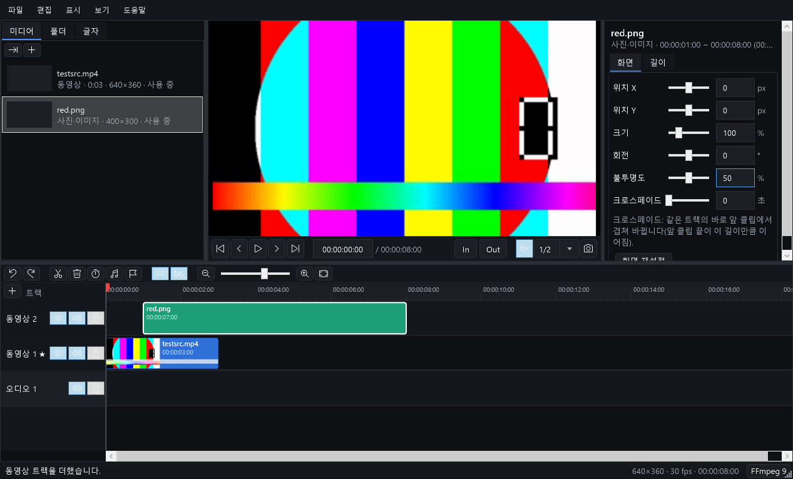
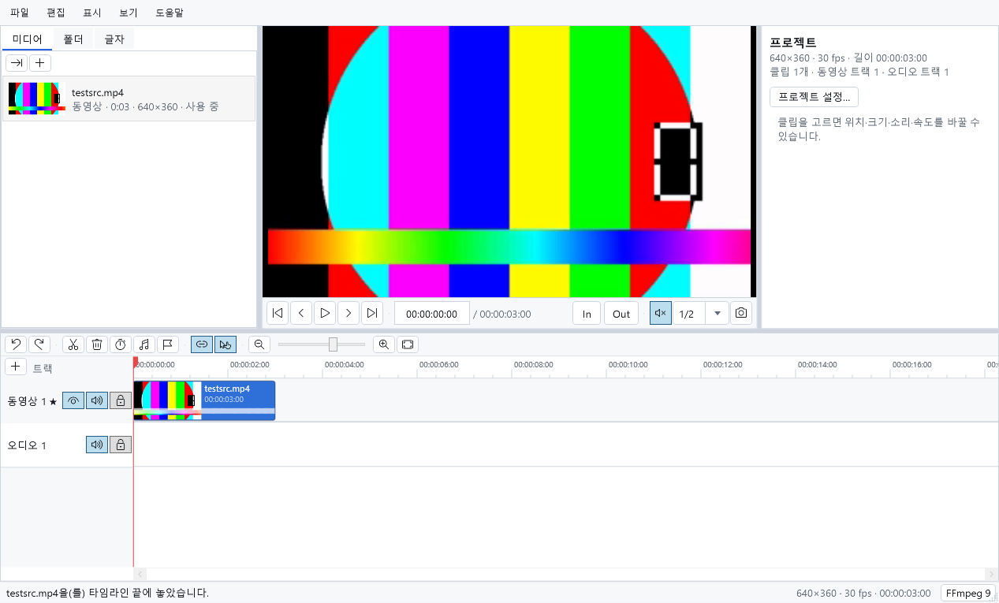
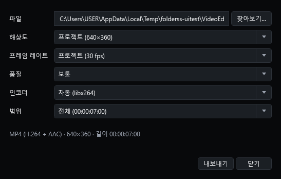
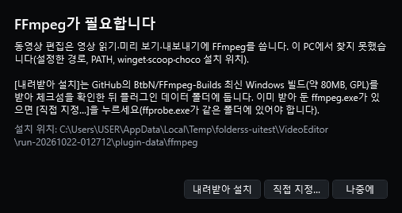

# Folderss 동영상 편집

[Folderss](https://github.com/zaruous/Folderss) 파일 관리자 안에서 쓰는 **다중 트랙 동영상 편집기** 플러그인입니다.
폴더에서 보던 동영상·사진·오디오를 그대로 타임라인에 놓고 자르고 이어 붙여 MP4로 내보냅니다.
화면은 프로젝트 트리 · 미디어 · 플레이어 · 속성 · 타임라인 다섯 영역이고, 단축키는 흔히 쓰는 영상 편집기 단축키(Ctrl+B 분할 등)를 따릅니다.



| | |
|---|---|
|  |  |

## 할 수 있는 것

| 영역 | 기능 |
|---|---|
| 미디어 | 동영상·사진(이미지)·오디오 가져오기(Ctrl+I, 끌어 놓기, Folderss 폴더 탭), 썸네일·길이, 두 번 눌러 타임라인 끝에 추가 |
| 타임라인 | 동영상 트랙 여러 개(위 트랙이 덮음 — 영상 위 사진·글자), 오디오 트랙(배경 음악·내레이션), 트랙 출력·소리·잠금, 트랙 추가/삭제 |
| 편집 | 끌어 옮기기(다른 트랙으로도), 가장자리 끌어 다듬기, 분할, 삭제·리플 삭제·빈틈 닫기, 재생 헤드까지 앞/뒤 다듬기, 붙기(편집점·재생 헤드·마커), **마그네틱 주 트랙**(동영상 1에 빈틈 없이), 실행 취소/다시 실행, 잘라내기·복사·붙여넣기, **사운드 분리**(영상·사운드를 나눠 링크 — 함께 옮기기, 어긋남 표시·싱크 맞추기, 다시 합치기, 미디어에서 바로 나눠 놓기, 사운드만 파일로 저장 — [사운드 분리](docs/sound-split.md)) |
| 클립 속성 | 위치·크기·회전·불투명도(미리 보기에서 클립을 눌러 고르고 끌어 옮기고 모서리로 크기 조절, 가운데에 붙음, 누른 뒤 화살표로 1px씩, Ctrl+누르기로 여럿 골라 함께 옮기기), 맞춤 방식(화면에 맞춤·화면 채우기·흐린 배경으로 채우기·늘이기 — 사진은 기본으로 화면을 꽉 채움, 설정에서 바꿈, 화면과 비율이 다른 미디어는 목록에 표시), 음량·페이드 인/아웃, 속도(소리 음높이 유지), 사진·글자 길이, 글자 내용·크기·색, 글자 상자(너비를 정하면 낱말 단위로 줄 나눔, 높이·세로 정렬 — 미리 보기 틀의 옆 손잡이로도) |
| 미리 보기 | 재생 헤드 화면, 재생(소리 시계에 맞춤), 프레임·초 이동, 타임코드 입력, 품질(전체·1/2·1/4), 스냅샷(PNG로 저장해 미디어에 추가) |
| 표시 | 마커(이름·색·메모), In/Out 점 |
| 자막 | SRT·VTT 가져오기(파일 > 자막 가져오기…, Ctrl+I, 끌어 놓기 — UTF-8·UTF-16·CP949) → 맨 위 "자막" 트랙에 큐로, 미리 보기·내보내기 때 화면 아래에 입힘(흰 글자·검은 윤곽선, 자동 줄바꿈 — FFmpeg libass), 큐 옮기기·다듬기·분할·삭제와 글 고치기, 음성 인식으로 자막 만들기(파일 메뉴·클립 오른쪽 메뉴 — 이 PC의 whisper.cpp, 처음 한 번 실행 파일과 모델을 받음, 대본을 주면 글은 대본에서 시각은 소리에서, 말하는 단어 노란색 강조, [음성 인식 자막](docs/speech-to-text.md)) |
| 효과 | 클립 사이 전환 60여 가지(디졸브·페이드·닦아내기·밀어내기·덮기·열고 닫기·조각·확대·모자이크·흐림, 하트·꽃·블라인드·바둑판 같은 모양) — [전환] 탭의 썸네일(마우스를 올리면 움직임)에서 골라 고른 클립에·모든 클립 사이에 넣거나 클립으로 끌어 놓기, 길이 조절, 타임라인 위치는 그대로(앞 클립이 그만큼 밑에 더 그려짐), 소리도 같은 크기감으로 겹쳐 바뀜, 미리 보기·내보내기 같음(FFmpeg xfade). 효과는 데이터(JSON)라 효과 폴더에 파일을 넣으면 늘어남([전환 효과 데이터](docs/transitions.md)). **동영상 효과**(클립 그림 위에 그림): 스캔 라인 — 흰 선과 색 빛의 띠가 위에서 아래로 훑음(아래로 휨·어두운 곳에서 떨림·빛 번짐·굵기·속도·색), 스캔 계열 — 쇼크웨이브 스캔·SF 스캔·레이 스캐닝·글리치 스캔, 글리치 — RGB 분할·블록 글리치·줄 밀림·나쁜 TV 신호(같은 시각이면 늘 같은 모양), 흔들림·줌 — 카메라 흔들림·지진·하트비트·빠른 줌·줌 바운스(그림을 틀 안에서 흔들고 키움, 빈 가장자리 없이) — 모두 14가지를 [효과] 탭에서 묶음별 썸네일로 골라(새로 더한 효과는 "새로" 표시, 클립을 고른 채 썸네일에 마우스를 올려 두면 그 클립에 얹은 모습을 미리 보기 화면에서 잠깐 봄) 동영상·사진 클립에 넣고 속성 패널 [효과] 탭에서 조절, 인물 마스크가 있으면 사람에게만([동영상 효과](docs/video-effects.md)) |
| 내보내기 | MP4(H.264 + AAC), 해상도·프레임 레이트·품질·인코더(x264 · NVIDIA · Intel · AMD · Windows), 전체 또는 In~Out, 진행률·취소 |
| 프로젝트 | `.fvproj` 저장/열기(미디어 경로는 프로젝트 기준 상대 경로), 첫 동영상에 맞춘 해상도·프레임 레이트, 맨 왼쪽 프로젝트 트리(📁 화면·소리·타임라인·파일 — 세로 9:16·정사각형, 샘플 레이트, 마그네틱, 다운로드 폴더 등), 저장 안 한 편집 복구(2분마다·Folderss 종료 때 써 두고 다음에 열 때 물음) |
| 인물 마스크 | 동영상·사진에서 사람만 따낸 흑백 마스크를 이 PC에서 만듦(클립·미디어 오른쪽 메뉴 [인물 마스크 만들기] — "사람에게만" 효과가 씀). AI 인물 분리 모델 MODNet(Apache-2.0, 처음 한 번 약 25MB를 받아 SHA-256 확인)과 ONNX Runtime(CPU), 진행률·취소, 원본 파일마다 한 번 만들어 두고 다시 씀. 동영상·사진은 인터넷으로 보내지 않음([인물 마스크](docs/person-mask.md)) |

없는 것(이후 과제): 인물 마스크 말고는 AI 기능, 스톡 미디어·템플릿, 키프레임 애니메이션, 색보정·LUT, 복합 클립·듀얼 타임라인.

## 설치

1. [Releases](https://github.com/zaruous/Folderss-video-editor/releases) 또는 Actions 아티팩트에서 zip을 받거나, Folderss의 **GitHub에서 설치**로 `zaruous/Folderss-video-editor`를 넣습니다.
2. Folderss `⋯ 메뉴 > 플러그인 > 동영상 편집`.

### FFmpeg

영상 읽기·미리 보기·내보내기는 [FFmpeg](https://ffmpeg.org)로 합니다. 플러그인 zip에는 들어 있지 않고, 처음 열 때 이렇게 찾습니다.

1. 설정한 폴더(Folderss 설정 > 동영상 편집)
2. `PATH`, winget(`Gyan.FFmpeg` 등)·scoop·choco·`C:\ffmpeg\bin` 같은 흔한 설치 위치
3. 플러그인이 내려받아 둔 폴더(`%LOCALAPPDATA%\Folderss\plugin-data\zaruous.folderss-video-editor\ffmpeg`)

못 찾으면 **FFmpeg 설치** 창이 뜹니다.



- **내려받아 설치**: GitHub [BtbN/FFmpeg-Builds](https://github.com/BtbN/FFmpeg-Builds) 최신 정식 Windows 빌드(win64 GPL shared, 약 80MB)를 받아, 같은 릴리스의 `checksums.sha256`과 SHA-256이 맞을 때만 `bin` 폴더 파일을 풉니다.
- **직접 지정…**: 이미 있는 `ffmpeg.exe`를 고릅니다(`ffprobe.exe`가 같은 폴더에 있어야 함).
- 직접 설치해도 됩니다: `winget install Gyan.FFmpeg`.

`FOLDERSS_VE_FFMPEG_SEARCH=off` 환경 변수를 주면 설정한 폴더와 내려받은 폴더만 봅니다(설치본이 여럿일 때 하나로 고정).

**미리 보기 도우미**: FFmpeg 폴더에 공유 DLL(`avcodec-63.dll` 등 — 내려받아 설치한 shared 빌드에 들어 있음)이 있으면, 편집기를 여는 동안 작은 도우미 프로세스(`helper\VideoEditor.Helper.exe`, [FFmpeg.AutoGen](https://github.com/Ruslan-B/FFmpeg.AutoGen) MIT)를 하나 띄워 두고 재생 헤드 이동·재생·효과 미리 보기·스냅샷을 그 안에서 그립니다. 프로세스 시작이 느린 PC에서 매번 `ffmpeg.exe`를 띄우던 1~2초 지연이 없어집니다. 도우미가 없거나(ffmpeg.exe만 있는 빌드) 실패하면 예전처럼 `ffmpeg.exe`로 그리고, 가져오기·내보내기는 늘 `ffmpeg.exe`를 씁니다. 상태 줄의 FFmpeg 단추에 "· 도우미"가 붙으면 쓰는 중입니다.
설치된 FFmpeg 9에 공유 DLL이 없으면(winget `Gyan.FFmpeg` full_build 등) 편집기를 열 때 한 번 알리고, FFmpeg 단추 창의 **[미리 보기용 DLL 받기]**로 같은 주 버전의 BtbN 공유 빌드(약 85MB)를 받아 체크섬을 확인한 뒤 도우미가 쓸 DLL 6개만 플러그인 데이터 폴더(`ffmpeg-preview\bin`)에 둡니다. 설치된 FFmpeg는 그대로 가져오기·내보내기에 씁니다. 알림은 같은 창에서 끌 수 있습니다.

### URL·유튜브에서 가져오기 (yt-dlp)

미디어 패널의 링크 단추, 오른쪽 클릭 또는 `파일 > URL에서 가져오기…`.

- **[주소]**: 직접 링크(`https://…/video.mp4` — https만, 리디렉션 5번·8GB·2시간 한도, 받은 뒤 ffprobe로 미디어인지 확인) 또는 유튜브 등 [yt-dlp](https://github.com/yt-dlp/yt-dlp)가 지원하는 주소. 유튜브는 [확인]으로 제목·길이·화질을 먼저 보고, 기본 화질은 프로젝트 높이 이하에서 가장 높은 것입니다.
- **[검색]**: 유튜브 검색(영상은 받지 않음, 20개씩 [더 보기]). 필터: 올린 날짜(오늘·이번 주·이번 달·올해), 길이, 크리에이티브 커먼즈만. 두 번 누르면 브라우저로 미리 봅니다. 최근 검색어 10개를 기억합니다.
- 받은 파일은 다운로드 폴더에 제목 이름으로 두고 미디어 목록에 더합니다. 다운로드 폴더는 창 아래 [바꾸기…] 또는 설정 탭에서 지정하고, 지정하지 않으면 프로젝트 파일 옆 `media` 폴더(저장 안 한 프로젝트면 플러그인 데이터 폴더 `media`)입니다. [폴더 열기]로 탐색기에서 열고, 받은 뒤에는 [탐색기에서 보기]로 그 파일을 고른 채 엽니다.
- 직접 링크는 브라우저 User-Agent로 받습니다(도구 이름을 막는 사이트가 있어서). GitHub에서 FFmpeg·yt-dlp를 받을 때는 플러그인 이름을 보냅니다.
- 프록시는 Folderss 본체와 같은 방식입니다: Windows 시스템 프록시(자동 구성 스크립트 포함)를 쓰고, 인증이 필요한 프록시에는 Windows 로그인 자격 증명을 넘깁니다. yt-dlp에는 같은 시스템 프록시 주소를 `--proxy`로 넘깁니다(yt-dlp는 Windows 로그인 인증 프록시를 지원하지 않음).

yt-dlp는 FFmpeg처럼 설정한 경로 → `FOLDERSS_VE_YTDLP` → `PATH` → winget·scoop 설치 위치 → 플러그인이 받은 폴더 순으로 찾습니다. 못 찾으면 설치 창이 뜨고, GitHub `yt-dlp/yt-dlp` 최신 `yt-dlp.exe`(약 18MB)를 `SHA2-256SUMS`와 맞을 때만 씁니다. JS 실행기(Deno → Node)가 없으면 Deno(GitHub `denoland/deno`, 약 43MB)도 함께 받을지 묻습니다. 플러그인이 받은 yt-dlp는 30일이 지나거나 낡아서 실패하면 새 릴리스로 바꾸고, 직접 설치한 것은 업데이트 안내만 합니다.

처음 쓸 때 유튜브 약관 안내와 체크박스가 뜹니다(체크해야 버튼이 켜짐, 확인하면 기억). 유튜브 약관은 허락한 방식 밖의 내려받기를 금지합니다 — 직접 올린 영상이거나 받을 권리가 있는 영상만 받으세요.

## 쓰는 법

화면은 다섯 영역입니다 — 맨 왼쪽 **프로젝트 트리**(위아래로 길게), 그 오른쪽 위에 **미디어** · **플레이어** · **속성**, 아래 **타임라인**. 경계는 끌어서 크기를 바꿉니다.
프로젝트 설정은 프로젝트 트리에서 폴더(화면 · 소리 · 타임라인 · 파일)를 고르고 아래에서 바꿉니다(실행 취소 가능). `보기 > 프로젝트 트리`로 숨기거나 다시 보이고, `파일 > 프로젝트 설정…`은 트리의 화면 폴더를 엽니다.

1. **가져오기**: Ctrl+I, 파일을 미디어 패널·타임라인에 끌어 놓기, 또는 [폴더] 탭에서 골라 [고른 파일 가져오기]. 빈 프로젝트에 처음 들어온 동영상의 해상도·프레임 레이트로 프로젝트가 맞춰집니다.
2. **놓기**: 미디어를 두 번 누르면 타임라인 끝에(사진·동영상은 동영상 1, 오디오는 오디오 트랙). 원하는 트랙·위치로 끌어 놓아도 됩니다(아래 빈 곳이면 새 트랙). 사진·글자의 기본 길이는 5초(설정에서 바꿈).
3. **편집**: 클립을 끌어 옮기고, 가장자리를 끌어 다듬고, 재생 헤드에서 Ctrl+B로 나눕니다. 끄는 동안 Alt를 누르면 붙기가 잠시 꺼집니다. 오른쪽 클릭 메뉴에 분할·삭제·속도·사운드 분리가 있습니다.
4. **영상 위에 사진·글자**: [글자] 탭에서 글자 추가, 또는 사진을 동영상 2 트랙으로 끌어 놓고 속성 패널에서 위치·크기·불투명도를 바꿉니다.
5. **내보내기**: Ctrl+E. In/Out을 찍어 두면 그 구간만 내보낼 수 있습니다.

### 단축키

| 분류 | 키 |
|---|---|
| 재생 | 재생/일시 정지 Space · 정지 Ctrl+/ · 이전/다음 프레임 ←/→ · 1초 Shift+←/→ · 이전/다음 편집점 ↑/↓ · 처음/끝 Home/End · 고른 클립 처음/끝 Shift+Home/End |
| 편집 | 분할 Ctrl+B · 삭제 Delete · 리플 삭제 Shift+Delete · 빈틈 닫기 Alt+Delete · 앞/뒤 다듬기 Alt+[ / Alt+] · 실행 취소 Ctrl+Z · 다시 실행 Ctrl+Y · 잘라내기/복사/붙여넣기 Ctrl+X/C/V · 모두 선택 Ctrl+A |
| 클립 | 속도·길이 Ctrl+R · 사운드 분리 Ctrl+Alt+D · 소리 끄기 Ctrl+Shift+M · 90° 회전 Ctrl+Alt+←/→ |
| 표시 | 마커 M · 마커 편집 Shift+M · 이전/다음 마커 Shift+↑/↓ · In I · Out O |
| 보기 | 확대 Ctrl+= · 축소 Ctrl+- · 맞춤 Shift+Z · 휠 = 가로 이동 · Ctrl+휠 = 확대/축소 · Shift+휠 = 세로 이동 |
| 파일 | 새로 Ctrl+N · 열기 Ctrl+O · 저장 Ctrl+S · 다른 이름 Ctrl+Shift+S · 가져오기 Ctrl+I · 내보내기 Ctrl+E |

복사·붙여넣기는 플러그인 안에서만 씁니다(Windows 클립보드는 건드리지 않음).

## 구조

```
src/VideoEditor/
├── Core/    편집 모델(WPF 없음): 프레임 정수 시간(FrameRate), Project·Track·Clip, TimelineEdits(놓기·다듬기·분할·리플·마그네틱·붙기),
│            EditorSession(실행 취소 — 상태 스냅숏), ProjectFile(.fvproj), ProjectSettings, RenderGraph(프로젝트 → FFmpeg filter_complex)
├── Media/   FFmpeg 실행: 찾기·버전·인코더(FfmpegTool), ffprobe, 내보내기(진행률·취소), 미리 보기 프레임·재생 스트림, 썸네일·파형,
│            내려받기(SHA-256 확인), 작업 개체(Folderss가 끝나면 FFmpeg도 끝남)
└── Ui/      WPF 화면(코드로 만듦): EditorView(배치·메뉴·단축키), EditorCommands(모든 명령), TimelineCanvas(직접 그림·마우스·접근성),
             TimelineView, MediaPanel, PlayerPanel + PreviewPlayer(NAudio), PropertyPanel, 대화상자
```

- **미리 보기 = 내보내기 그래프**: 같은 `RenderGraph`를 미리 보기 크기로 돌려 BGRA 프레임을 받습니다. 보이는 것과 내보낸 결과가 같습니다.
- 디코딩·인코딩은 모두 **별도 FFmpeg 프로세스**라 코덱 오류가 Folderss를 함께 끝내지 않습니다.
- 위치·길이는 프로젝트 프레임 레이트의 정수 프레임이라 컷이 반올림 오차로 밀리지 않습니다(29.97처럼 유리수 레이트도).

## 개발

요구: Windows, .NET 8 SDK, 시험에는 FFmpeg.

```powershell
dotnet build                                   # 플러그인 zip: src/VideoEditor/bin/Debug/net8.0-windows/VideoEditor.zip
$env:FOLDERSS_VE_FFMPEG = "C:\ffmpeg\bin"       # 시험이 쓸 FFmpeg 폴더(없으면 PATH 등에서 찾음)
dotnet test tests/VideoEditor.Tests            # 단위 + 실제 FFmpeg 통합 시험(픽셀 색·프레임 수·음량·크로스페이드·취소·내려받기)
$env:FOLDERSS_VE_PERSONMASK = "C:\models\person-mask"  # (선택) 인물 분리 모델(modnet-fa2fa546.onnx)이 든 폴더 — 있으면 실제로 마스크를 만드는 시험도 돈다
pwsh scripts/ui-test.ps1                       # 화면 시험(숨은 데스크톱): 가져오기→편집→내보내기, 재생, 끌기·다듬기, 속성, 글자·마커, 테마 7종
scripts\run-host.bat                           # Folderss 없이 이 플러그인만 개발용 호스트(tools/DevHost)로 띄우기
```

- `scripts\run-host.bat [Release] [--theme Light] [--fresh] [--data 폴더] [--wait]`은 플러그인 zip과 `tools/DevHost`를 빌드한 뒤, zip을 Folderss와 같은 방식(PluginLoadContext → Initialize → CreateView)으로 불러 창에 띄웁니다. 창 위 막대에서 테마를 바꾸고 플러그인 설정 화면을 엽니다. 플러그인 데이터는 실제 Folderss와 따로 `%LOCALAPPDATA%\Folderss-devhost\<플러그인 id>`에 남고, `--fresh`는 빈 데이터로 시작합니다. Visual Studio에서 DevHost를 시작 프로젝트로 두고 F5를 누르면 플러그인 코드의 중단점에 걸립니다.
- `scripts\run-host.bat --headless [--shot 파일.png] [--settle 초] [--timeout 초]`는 사용자 화면에 띄우지 않고 숨은 데스크톱(화면 시험과 같은 방식)에서 불러 그려 본 뒤 스스로 끝납니다. 기록과 결과는 콘솔에 나오고, 종료 코드는 0 성공 · 1 플러그인 UI 오류 · 2 불러오기 실패 · 3 시간 초과(사람이 닫아야 하는 창에서 멈춤)입니다. 화면을 눌러 보는 흐름까지 확인하려면 `scripts/ui-test.ps1`(화면 시험)을 씁니다.

- `tests/VideoEditor.Tests`는 Core·Media를 net8.0으로 링크해 CI(Ubuntu, 배포판 FFmpeg)에서도 돕니다.
- 미리 보기 도우미 시험(`PreviewHelperTests` — 도우미의 화면·소리가 ffmpeg.exe와 같은지, 1080p 재생 헤드 이동·재생 시작 시간, 끝났을 때 ffmpeg.exe로 돌아가기)은 Windows에서 `FOLDERSS_VE_FFMPEG`가 공유 DLL이 든 빌드(BtbN win64 gpl-shared의 `bin`)일 때만 돕니다. 화면 시험도 같은 폴더로 도우미가 있는 경로를, 공유 DLL이 없는 빌드면 없는 경로를 봅니다.
- `tests/VideoEditor.UiTests`는 [플러그인 템플릿](https://github.com/zaruous/FolderssPLuginTemplate)의 헤드리스 시험 호스트입니다. 사용자 화면에 창을 띄우지 않고, 캡처는 실행 끝에 나오는 `shots` 폴더에 남습니다. Visual Studio 테스트 탐색기에서 `SmokeHeadlessTests.OpenView`를 **디버그**로 실행하면 편집 창이 화면에 떠서 중단점을 쓸 수 있습니다.
- 계획 문서: [PRD](docs/PRD.md) · [구현 계획](docs/plan.md) · [꾸민 글자 구현 계획(#3)](docs/styled-text.md) · [전환 효과 데이터](docs/transitions.md) · [음성 인식 자막](docs/speech-to-text.md) · [사운드 분리](docs/sound-split.md) · [인물 마스크](docs/person-mask.md)

## 라이선스

[MIT](LICENSE). FFmpeg는 플러그인에 들어 있지 않으며, 내려받는 빌드는 FFmpeg 프로젝트의 GPL 라이선스를 따릅니다. 미리 보기 소리 재생에 [NAudio](https://github.com/naudio/NAudio)(MIT)를 씁니다.
인물 마스크에 [ONNX Runtime](https://github.com/microsoft/onnxruntime)(MIT — zip의 `licenses\`에 라이선스·제3자 고지)을 넣어 쓰고, 모델 [MODNet](https://github.com/ZHKKKe/MODNet)(Zhanghan Ke 외, Apache-2.0)의 ONNX 변환 [Xenova/modnet](https://huggingface.co/Xenova/modnet)(Apache-2.0)은 처음 쓸 때 내려받습니다(플러그인에 들어 있지 않음).
